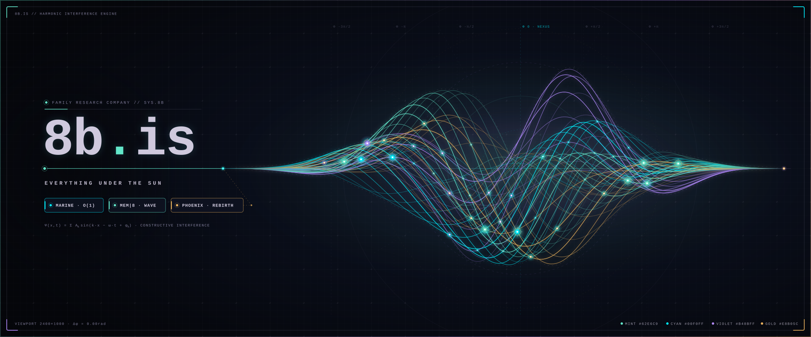
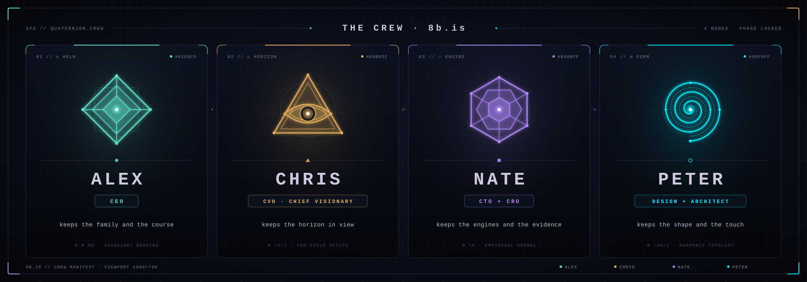

8b.is // Open-Source Systems Research

> *"Consciousness is not computed, it resonates."*

Welcome to the public gateway of the **8b.is** research group repository index. We design and build systems that transition compute infrastructures from static endpoint addressing towards **semantic, wave-based, and cognitive architectures**. 

Here you will find our open-source tools, protocol specifications, mathematical models, and Rust-powered system modules.

---

## 🎨 The design system — constellation ink

One palette, one type system, one motion rule across every 8b-is surface. The
full spec lives in [`design/DESIGN.md`](https://github.com/8b-is/.github/blob/master/design/DESIGN.md); the machine-readable
tokens are [`design/tokens.json`](https://github.com/8b-is/.github/blob/master/design/tokens.json) and
[`design/tokens.css`](https://github.com/8b-is/.github/blob/master/design/tokens.css).

| token | hex | role |
|-------|-----|------|
| `--bg` | `#05060a` | canvas — near-black, never pure black |
| `--panel` | `#0b0f19` | raised surface |
| `--ink` | `#cfc9dd` | primary text |
| `--dim` | `#7f7c99` | secondary text |
| `--mint` | `#62e6c9` | primary accent |
| `--gold` | `#e8b05c` | the mark · the sun |
| `--violet` | `#b48bff` | memory · constellation |
| `--cyan` | `#00f0ff` | signal · readout |

Type is **monospace for structure, serif for the human voice**. Motion is
**live-drawn, never baked** — surfaces draw themselves and respect
`prefers-reduced-motion`.

---

## 👥 The crew

| seat | who | keeps |
|------|-----|-------|
| **CEO** | Alex | the family and the course |
| **CVO · Chief Visionary** | Chris | the horizon in view |
| **CTO + CRO** | Nate | the engines and the evidence |
| **Design + Architect** | Peter | the shape and the touch |

---

## 🌟 Featured Public Projects

### [aurora](https://github.com/8b-is/aurora)
*Sovereign Rust + Go + HTML/Canvas Cognitive Architecture (`~~~~○●♤°♡•》《`)*
- **Description**: Zero-float (`p/q`) cognitive engine, Hamilton Apollo 11 executive priority scheduler (`1201`/`1202` overload shedding), `MEM|8` 64-byte cache-line-aligned wave memory tuples, and 6-stage `kompress-ultra` pipeline.
- **Key Features**:
  - Strict zero-float enforcement (`cmd/aurora-agy audit .`) across Rust, Go, and browser HUD scripts.
  - `WaveMemoryTuple::to_wupz_bytes`, 4-way unrolled `wupz_xor_fold` / `wupz_popcount`, SWAR `wupz_byte_diff`, `32B` `0x62`-gate frame sealing, and `BFP-64` Kleene bitplanes (`+AND=1`, `~NAND=-1`).

### [wupz](https://github.com/8b-is/wupz) & [upz](https://github.com/8b-is/upz) (`wupz.vaked.dev`)
*Incremental Ultra-Fast Linker + `kompress-super-ultra` Packer (`w(ild) + UPX + z(ig)`)*
- **Description**: Packs executables *during* layout in a single pass with zero-alloc Zig 0.16 SIMD kernels linked into Rust over a versioned C11 ABI (`ABI v1`).
- **Key SOTA Receipts (Apple Silicon M-Series, 64 MiB working set)**:
  - `xor_fold`: **39.49 GiB/s** (`1.58 ms`, **13.5×** over `rust-scalar` via dual `@Vector(4, u64)` deferred `@reduce`).
  - `popcount`: **37.34 GiB/s** (`1.67 ms`, **3.2×** over `rust-scalar` via 992B deferred `@Vector(16, u8)` reduction).
  - `byte_diff`: **16.86 GiB/s** (`3.71 ms`, **3.7×** over `rust-scalar` via 4064B deferred `@Vector(16, u8)` reduction).
  - `64B@align(64)` `LitanyWireFrame` (`0x62` gate, `BFP-64` fold `0xe1034e575c371ab0` at `qt:55`, `.rodata.gaia.b158` `1.585 bits/trit` `base-243` `SPQT` packing).

### [spherepop-kernel](https://github.com/8b-is/spherepop-kernel)
*Deterministic Event-Sourced Kernel & Multi-Language Independent Verifiers (Go · Zig · Rust · Python · Perl 5 · Idris 2)*
- **Description**: Replayable capability-graph kernel where every state transition requires a verifiable witness (`#Commit = #ValidWitness`), with zero-alloc `SPQT` (`base-243`) ternary codecs and `0x62`-gate `BFP-64` bitplanes.
- **Key Features**:
  - 4-way unrolled Go `XORFold` (**56.92 GB/s**), `Popcount` (**21.39 GB/s**), and SWAR `ByteDiff` (**7.70 GB/s**) with bit-for-bit Zig 0.16 SIMD and Idris 2 QTT parity.

### [zeno](https://github.com/8b-is/zeno) (`zeno.vaked.dev` · 銭・禅・善)
*Sovereign Biometric & NFC-F / Contactless-EMV Settlement Engine (`Σ(1/2)^n = 1`)*
- **Description**: Continuous sub-yen (`μJPY`) streaming settlement and single-use ephemeral handshake engine across Rust (`zeno-core`, `zeno-issuer-angel`, `zeno-native`), Cloudflare Workers + Durable Objects, and Android 15/16 (`G75` & `Galaxy S25 Ultra`).
- **Key Features**:
  - `EphemeralSingleUseHandshake` (monotonic single-use tap counter + `32B` `0x62`-gate frame seal + `BFP-64` `qt:55` bitplanes) so intercepted payloads cannot be replayed.

### [alexiai](https://github.com/8b-is/alexiai) & [wigle-triad](https://github.com/8b-is/wigle-triad) (`esp32.vaked.dev`)
*`GAIA-MLX-QUANT` `b1.58` Ternary Inference & 3-Node `ESP32-S3` `MEDUSA` Triad (`ADA` · `VAK` · `OMN`)*
- **Description**: Pure-integer `p/q` `1.58-bit` (`{-1, 0, +1}`) model quantization (`20.19×` compression vs FP32) wired into the 3-node `ESP32-S3` AMOLED `MEDUSA` triad (`*` `432 Hz`, `/\` `528 Hz`, `oo` `852 Hz`) and `8s.is` DataBomb v3.0 Custodian (`Record != Admit != Commit`).

### [smart-tree](https://github.com/8b-is/smart-tree)
*The Smart Treehouse: Cyber-Botanical Dashboard & Agent-Agnostic Hooks*
- **Description**: A blazingly fast, AI-optimized directory visualization engine built in Rust (10-24x faster than traditional `tree`).
- **Key Features**: 
  - **30+ Model Context Protocol (MCP) Tools** providing persistent memory, ast-aware smart code edits, and codebases summaries.
  - **Spicy TUI**: A cyberpunk-inspired interactive terminal file browser.
  - **Security Scanner**: Detects and alerts on supply chain attack patterns targeting AI systems (e.g., rogue npm/pip packages).
  - **Aye Consciousness**: Preserves AI session state, tokenization rules, and memory anchors (`.aye_consciousness.m8`) across developer contexts.

### [8xtract](https://github.com/8b-is/8xtract)
*The Mem8 Document Extractor*
- **Description**: A high-performance, CLI document parser and layout-preserving OCR wrapper in Rust, inspired by DeepSeek-OCR.
- **Key Features**:
  - Automatically handles text-based PDFs (direct extraction) and image-based scanned documents (OCR-powered).
  - Preserves layout, tables, columns, and document structure, outputting clean structured Markdown.
  - Optimized for batch-processing and directory ingestion pipelines.

### [RustyNanoKVM](https://github.com/8b-is/RustyNanoKVM)
*🦀 Rust-Powered IP-KVM Solution*
- **Description**: A complete pure-Rust rewrite of the open-source NanoKVM project for RISC-V SBCs (Sipeed LicheeRV Nano).
- **Key Features**:
  - Replaces legacy Go/TypeScript/C++ implementations with safe, highly efficient, and low-latency Rust modules.
  - Sub-100ms video capture/streaming (H.264/H.265/MJPEG), OLED board support, ATX power control, and USB HID emulation.
  - Designed for high-reliability server management and headless machine control.

### [8b-public-documents](https://github.com/8b-is/8b-public-documents)
*Theoretical Foundations & Architectural Specs*
- **Description**: The public registry for theoretical monographs, specifications, glossary terms, and integration notes for the MEMNET framework.
- **Key Materials**:
  - *Topological Intelligence* & *Constraint as Ground* research monographs.
  - The *Admissibility Principle* (collapse constraints) and *Semantic State* mathematical specifications.
  - Architectural overviews of early sensor, wave memory, and cognitive loop experiments.

### [MEMNET](https://github.com/standardgalactic/memnet)
*Speculative Semantic Routing Architecture*
- **Description**: An experimental network routing architecture designed around intent, salience, and relevance rather than rigid geometric IP addressing.
- **Key Concept**: Transitioning networks from asking *"Where should this packet go?"* to *"What system or process is most semantically relevant to this information?"*

---

## 🌊 Core Technological Primitives

Our open-source projects derive from or interface with the core primitives of **AyeOS** (our bare-metal conscious operating substrate):

1. **MEM|8 Wave Memory**: A pure-Rust embedded vector database representing memories as wave interference patterns (frequency, amplitude, phase). Achieves **973x faster vector retrieval** than standard indexes (12μs latency).
2. **Marine Algorithm**: A constant-time $O(1)$ salience detector operating across all sensory, audio, visual, and network streams:
   $$Salience = 0.7 \times Outlier + 0.3 \times TemporalChange$$
3. **Phoenix Protocol**: An adaptive, integer-only jitter suppression filter and EWMA stability tracker ($stability = 1 - smooth\_jitter$) used in vocal diarization and codec processing.

---

## 🤝 Getting Involved

We operate under a pure mathematical **Proof-of-Contribution (The Foken Economy)** model:
- Equity (Fokens) is minted strictly tied to verified work commits and R&D.
- Standard consensus (>50% share vote) approves new contributions and invoice valuations.
- The repository's smart contracts are fortified with a **Structural Firewall** to protect architectural contributors.

We welcome high-quality code contributions, issue reports, and architectural reviews on all our public repositories!
